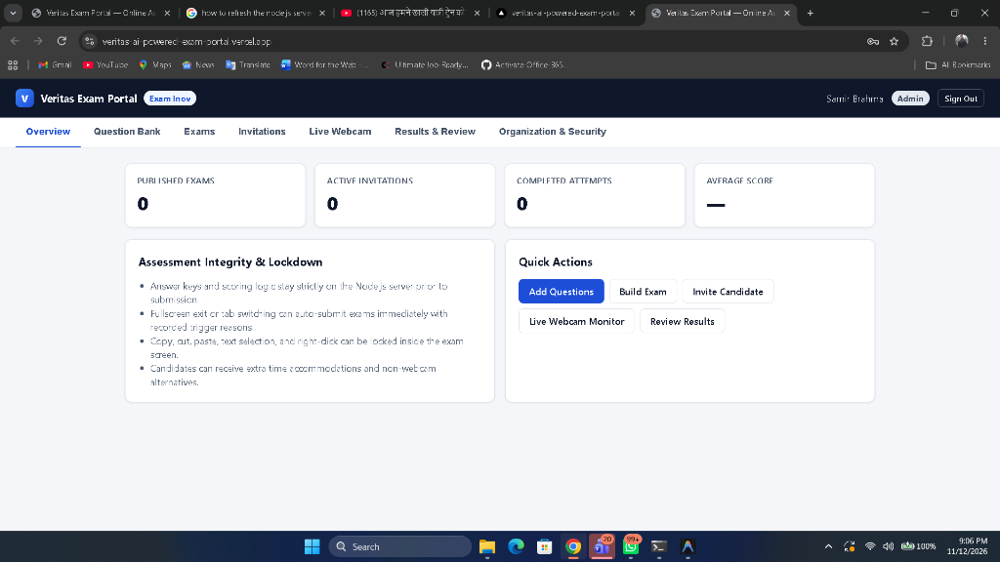

# Veritas — Online Exam Portal

A full-stack, browser-based MCQ assessment platform built for companies, interviewers, and reviewers using **Next.js 15 (JavaScript)** and **Node.js / Express (ESM JavaScript)** with dual support for **local SQLite (`node:sqlite`)** and **Supabase PostgreSQL (`pg`)**, ready for **Vercel** deployment.

---

## Screenshots

### Admin & Staff Portal Overview


---

## Key Features

### Organization, Roles & Security
- **Multi-tenant Organization Accounts:** Isolated per-organization data with configurable candidate data retention policies and one-click PII anonymization/purge.
- **Role-Based Access Control (RBAC):** `Admin`, `Interviewer`, and `Reviewer` roles enforced strictly on the server.
- **Authentication & Protection:** `scrypt` password hashing, HMAC-signed `HttpOnly` session cookies, `X-CSRF-Token` protection, optional **TOTP Multi-Factor Authentication (MFA)**, IP rate limiting, and full security audit logging.

### Assessment & Candidate Workflow
- **Question Bank & Pool Draws:** Tag questions by pool and difficulty, configure point weights and negative marking, attach explicit questions or draw randomly per candidate, and shuffle both question order and option order.
- **Expiring Candidate Invitations:** Unique SHA-256-hashed candidate links with expiry controls, link regeneration/revocation, extra-time accommodations, and webcam waivers.
- **Pre-Exam Onboarding & Device Check:** Rules, allowed materials, privacy notice, explicit consent, connectivity latency test, and optional camera/microphone check.
- **Server-Controlled Timer & Autosave:** Continuous answer autosave with `localStorage` offline queuing and automatic sync on reconnect, plus admin/interviewer **Grant Extra Time & Reopen** support.
- **Server-Side Scoring:** Answer keys and grading logic stay strictly on the server and are never sent to the candidate browser prior to submission.

### Proportionate Exam Integrity & Live Webcam Preview
- **AI Face Tracking Anti-Cheat (Groq LLM):**
  - Real-time client-side face tracking powered by `@vladmandic/face-api` (TinyFaceDetector + 68-point landmarks) running directly in the candidate's browser via WebAssembly/TensorFlow.js.
  - Detects **face presence**, **multiple faces** (unauthorized helpers), and **gaze deviation** (looking away at notes/phone) without streaming raw video recordings to the backend.
  - Aggregated signal windows are analyzed in real time by **Groq (`llama-3.1-8b-instant`)** to generate an automated cheating risk verdict (Low, Medium, High) with human-readable reasoning and risk flags displayed live in the admin portal.
- **Strict Lockdown Options:**
  - `auto_submit_on_violation`: Automatically submits the attempt and logs the reason (`tab_switched` / `fullscreen_exited`) if a candidate switches tabs or exits fullscreen.
  - `lock_copy_paste`: Blocks copy, cut, paste, text selection, drag, context menu, and clipboard/DevTools shortcuts inside the exam view while logging `copy_paste_blocked` events.
- **Live Webcam Monitoring:**
  - Admins/interviewers can require live webcam monitoring **per exam** or **per candidate invitation** (toggleable anytime).
  - Real-time preview inside the **Live Webcam** tab and **Attempt Review** modal via WebSocket relay (`/live-webcam`) with automatic HTTPS/serverless frame fallback—**zero video recordings or history are written to disk**.
- **Human-Review Context:** Browser signals (tab switches, window blur, fullscreen exits, face tracking events) are presented strictly as review context rather than automated misconduct verdicts.

---

## Project Structure

```text
├── backend/                     # Node.js 22+ (ESM JavaScript, Express)
│   ├── api/index.js             # Vercel serverless handler exporting Express app
│   ├── vercel.json              # Vercel routing config for backend deployment
│   ├── supabase/schema.sql      # PostgreSQL schema for Supabase
│   ├── src/
│   │   ├── config.js            # Auto-loads backend/.env & runtime settings
│   │   ├── db.js                # Dual SQLite (node:sqlite) + Supabase PostgreSQL (pg) adapter
│   │   ├── security.js          # scrypt, TOTP MFA, HMAC cookies, CSRF, rate limiter
│   │   ├── scoring.js           # CSPRNG question/option shuffling & server grading
│   │   ├── services.js          # Domain logic, RBAC, live webcam state, audit & retention
│   │   ├── app.js               # Express API router & security headers
│   │   ├── websocket.js         # In-memory WebSocket relay for live webcam
│   │   ├── server.js            # HTTP + WebSocket server entrypoint
│   │   ├── seed.js              # Demo organization, exam & invite seeder
│   │   └── migrate-to-supabase.js # Migrates local SQLite rows to Supabase PostgreSQL
│   └── tests/
│       └── portal.test.js       # End-to-end & unit tests (node:test)
└── frontend/                    # Next.js 15 App Router (JavaScript)
    ├── next.config.mjs          # Proxies /api/* to BACKEND_URL + security headers
    ├── scripts/https-proxy.mjs  # Local HTTPS dev proxy (port 3443) for mobile camera testing
    └── src/
        ├── lib/api.js           # API fetch & WebSocket URL helpers
        └── app/
            ├── page.js          # Staff Portal (Overview, Questions, Exams, Invites, Live Webcam, Results, Security)
            └── candidate/page.js# Candidate Exam Runner (/candidate?token=...)
```

---

## Prerequisites

- **Node.js 22.5+** (for built-in `node:sqlite` and `node:test`) and `npm`.

---

## Local Development

### 1. Backend Setup (`http://127.0.0.1:4000`)

```bash
cd backend
cp .env.example .env    # Or edit backend/.env directly
npm install
npm run seed            # Optional: seeds a sample org, questions, exam, and invite
npm run dev             # Or: npm start
```

Run tests:

```bash
cd backend
npm test
```

### 2. Frontend Setup (`http://localhost:3000`)

```bash
cd frontend
cp .env.example .env    # Or edit frontend/.env directly
npm install
npm run dev
```

- **Staff Portal:** `http://localhost:3000`
- **Candidate Exam Link:** `http://localhost:3000/candidate?token=...`

### 3. Testing Camera Access on a Mobile Phone (Local Wi-Fi)

Mobile browsers block `navigator.mediaDevices` on plain `http://` LAN IPs. Start the included local HTTPS proxy alongside `npm run dev`:

```bash
cd frontend
npm run dev:https       # Exposes https://<your-lan-ip>:3443 -> http://127.0.0.1:3000
```

Open `https://<your-lan-ip>:3443/candidate?token=...` on your phone (accept the local dev certificate once).

---

## Migrating Data to Supabase (PostgreSQL)

1. In the Supabase Dashboard, go to **Project Settings → Database → Connect → Method: Session pooler** (IPv4-compatible for local networks and Vercel) and copy the URI.
2. Paste it into `backend/.env` as `DATABASE_URL=postgresql://...` (replacing `[YOUR-PASSWORD]` with your database password).
3. Run the migration script:

```bash
cd backend
npm run migrate:supabase
```

This creates all PostgreSQL tables and copies all existing data from `backend/data/exam_portal.db` safely (`ON CONFLICT DO NOTHING`).

---

## Deploying to Vercel

Deploy **`backend/`** and **`frontend/`** as two Vercel projects from this repository (with **Supabase** as the database):

### Backend Project (`Root Directory: backend`)
Add these Environment Variables in Vercel:
- `DATABASE_URL`: Supabase **Session pooler** PostgreSQL URI
- `DB_SSL`: `1`
- `EXAM_PORTAL_SECRET`: 64-character random hex secret
- `EXAM_PORTAL_COOKIE_SECURE`: `1`
- `EXAM_PORTAL_COOKIE_SAMESITE`: `Lax`
- `CORS_ORIGIN`: `https://<your-frontend-domain>.vercel.app`
- `GROQ_API_KEY`: Groq Cloud API key (from [console.groq.com](https://console.groq.com)) for AI face tracking analysis
- `GROQ_MODEL`: `qwen/qwen3.8-27b` (recommended default), `openai/gpt-oss-120b`, or `openai/gpt-oss-20b`

### Frontend Project (`Root Directory: frontend`)
Add this Environment Variable in Vercel:
- `BACKEND_URL`: `https://<your-backend-domain>.vercel.app`
- Leave `NEXT_PUBLIC_API_BASE` blank so Next.js `rewrites()` proxies `/api/*` through your frontend domain (keeping `HttpOnly` session cookies first-party).
